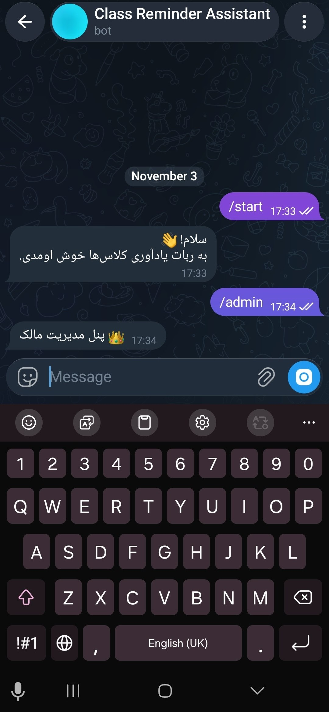
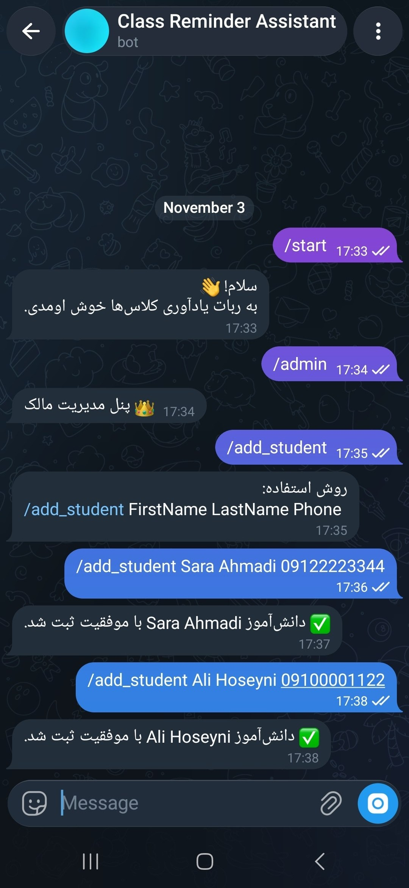
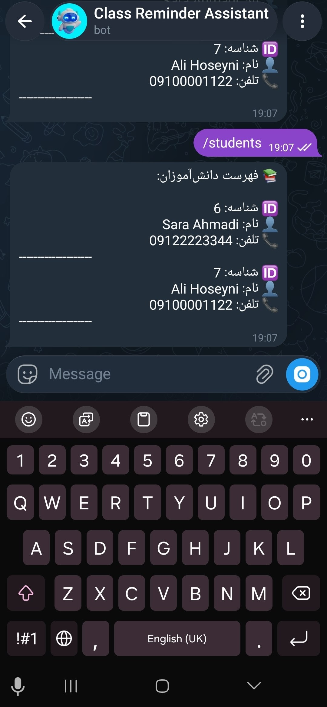
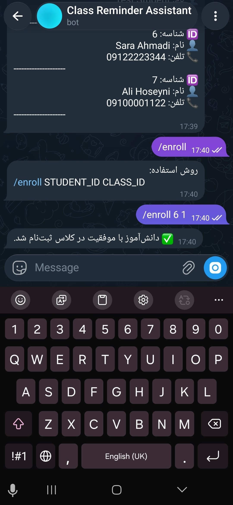
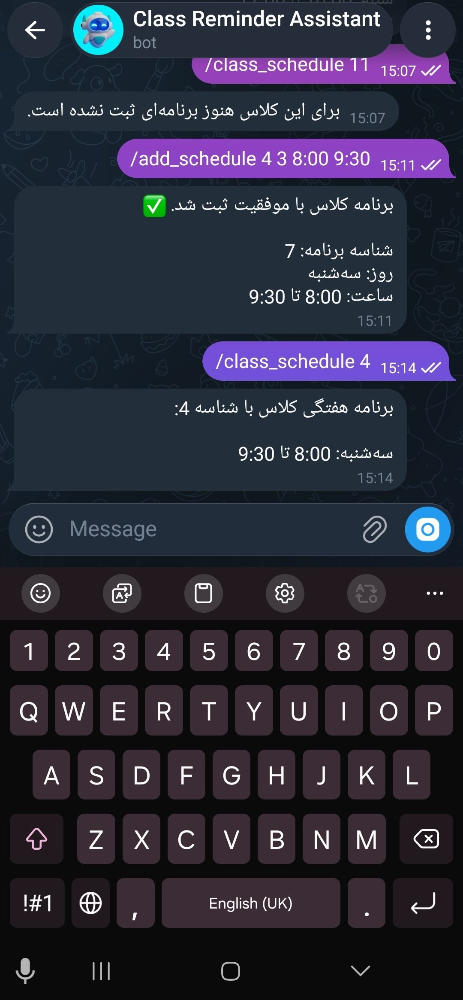

# Telegram Class Management Bot

A Telegram bot built with Python to help administrators manage students, classes, weekly schedules, and class announcements.

## Features

- Admin management: Add and remove administrators.
- Student management: Register, list, and delete students.
- Class management: Create and view classes.
- Student enrollment: Enroll students in classes and view class memberships.
- Weekly schedules: Define and view class schedules.
- Secure Telegram account linking: Generate one-time linking codes that expire after 24 hours.
- Account unlinking: Disconnect a student's Telegram account without deleting their student record.
- Class announcements: Send announcements to students enrolled in a specific class.
- Delivery report: View successful, failed, unlinked, and uncertain message delivery counts.

«Note: Automatic scheduled class reminders have not been implemented yet. The bot currently supports weekly schedule management and manual class announcements.»

## Technologies

- Python
- python-telegram-bot
- SQLite
- python-dotenv

## Available Commands

### General

- "/start" — Start the bot.
- "/start CODE" — Link a student's Telegram account using a valid linking code.
- "/admin" — Display the admin panel.

### Administrator Management

- "/add_admin USER_ID" — Add a new administrator. Owner only.
- "/remove_admin USER_ID" — Remove an administrator. Owner only.

### Student Management

- "/add_student FIRST_NAME LAST_NAME PHONE" — Register a new student.
- "/students" — Display the student list.
- "/delete_student STUDENT_ID" — Delete a student.
- "/unlink_student STUDENT_ID" — Disconnect a student's Telegram account.

### Class Management

- "/add_class CLASS_NAME" — Create a new class.
- "/classes" — Display all classes.
- "/enroll STUDENT_ID CLASS_ID" — Enroll a student in a class.
- "/student_classes STUDENT_ID" — Display the classes assigned to a student.
- "/class_students CLASS_ID" — Display students enrolled in a class.

### Schedule Management

- "/add_schedule CLASS_ID DAY START_TIME END_TIME" — Add a weekly schedule for a class.
- "/class_schedule CLASS_ID" — Display a class's weekly schedule.

### Weekday values:

- "0" — Saturday
- "1" — Sunday
- "2" — Monday
- "3" — Tuesday
- "4" — Wednesday
- "5" — Thursday
- "6" — Friday

### Telegram Account Linking

- "/generate_link STUDENT_ID" — Generate a secure, one-time Telegram linking code for a student.
- The student can use "/start CODE" to link their Telegram account.
- Linking codes expire after 24 hours and can only be used once.

### Announcements

- "/announce CLASS_ID MESSAGE" — Send an announcement to all linked students enrolled in the selected class.

The bot reports the number of successful deliveries, unlinked students, failed deliveries, and uncertain deliveries.

## Installation

1. Clone the repository

```bash
git clone https://github.com/Yasamana1992/Class-Reminder-Bot.git
cd Class-Reminder-Bot
```

2. Create a virtual environment

```bash
python -m venv .venv
```

Activate it on Windows:

```bash
.venv\Scripts\activate
```

3. Install dependencies

```bash
pip install python-telegram-bot==22.8 python-dotenv
```

## Environment Variables

Create a ".env" file in the project root directory:

```bash
TELEGRAM_BOT_TOKEN=your_bot_token
OWNER_ID=your_telegram_user_id
```

Replace the placeholder values with your own credentials.

Important: Never share your bot token or commit the ".env" file to GitHub.

## Database Initialization

Initialize the SQLite database by running:

```bash
python database.py
```

## Run the Bot

Start the bot with:

```bash
python bot.py
```

## Database

The project uses SQLite to store:

- Administrators
- Students
- Classes
- Weekly class schedules
- Student-class enrollments
- Telegram account linking information

Foreign key constraints are enabled to maintain relationships between database records.

## Security

- Bot credentials are stored in environment variables.
- Linking codes are generated securely.
- Only hashed linking codes are stored in the database.
- Linking codes expire after 24 hours and are single-use.
- Administrative commands are protected by role-based access checks.

## Future Improvements

- Automatic scheduled class reminders
- Improved error logging
- More flexible schedule management
- Automated tests

## screenshots 

### Bot Welcome & Admin Panel


### Adding Students


### Students List


### Student Enrollment


### Class Schdule


## Author

Yasaman Abbasi

GitHub: "Yasamana1992" 